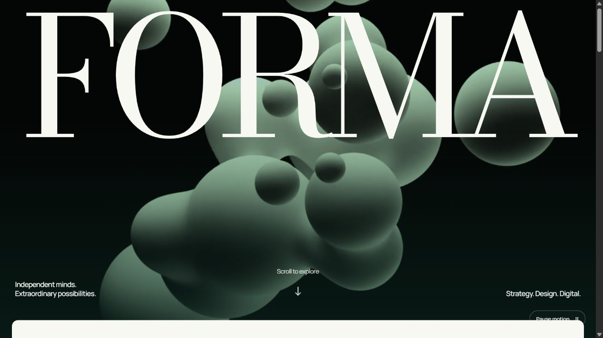

# FORMA — Digital Agency Website

A website for FORMA, a made-up independent creative studio. Big serif type, a forest-green palette and scroll-driven motion. Built with Next.js 16, React 19, GSAP and Swiper.

**[Live site →](https://forma-digital-agency.vercel.app/)**



> The layout and interactions are modelled on [Landor](https://landor.com/)'s site. The identity, colours, copy, case studies and code are my own. No source code, fonts or project media were copied. [`docs/design-reference.md`](docs/design-reference.md) maps each reference pattern to how it was adapted.

## Pages

| Route | What's there |
| --- | --- |
| `/` | Full-screen video hero with the FORMA wordmark, a scroll-expanding intro panel, a showreel in a native `<dialog>` player, a featured-work carousel, a services section and a dotted world map |
| `/our-work` | Two-column project grid (one column on mobile) |
| `/our-work/[slug]` | Eight statically generated case studies, each with an opening visual, breadcrumbs, a narrative and a gallery |
| `/contact-us` | A searchable list of locations showing each city's live local time, a zoomable map with pins, and an enquiry form |
| `/join-us` | Role cards you can filter by team, each opening a dialog with details |
| `/privacy-policy`, `/cookie-policy`, `/terms-of-use` | Policy pages, all served by one dynamic route |

## Highlights

- **Scroll animation with GSAP ScrollTrigger.** Elements fade in as you reach them, images drift with parallax, the hero wordmark fades out, the intro panel widens and the statement lines stagger in. It all lives in one client component ([`motion.tsx`](src/components/motion.tsx)) that reruns on every route change.
- **Respects reduced motion.** Animations are inside `gsap.matchMedia('(prefers-reduced-motion: no-preference)')`. Background videos pause for users who prefer reduced motion, pause when scrolled out of view, and have a visible pause button.
- **Carousel built on Swiper.** Swipe, arrows, dots and autoplay.
- **No backend.** The contact form turns your input into a `.txt` enquiry you can download, so nothing is sent anywhere. The careers page links into it with `?enquiry=Careers` preset.
- **Self-hosted fonts.** Bodoni Moda and Manrope are served from `/public/fonts` (both OFL-licensed), with no requests to Google Fonts.
- **Responsive.** Checked at 375px, 768px and desktop widths with no page-level horizontal scroll.

## Tech stack

- [Next.js 16](https://nextjs.org/) (App Router) and React 19
- TypeScript
- [GSAP](https://gsap.com/) with ScrollTrigger
- [Swiper](https://swiperjs.com/)
- Plain CSS in [`globals.css`](src/app/globals.css), no UI framework
- Deployed on Vercel

## Project structure

```
src/
├── app/
│   ├── page.tsx              # Home
│   ├── our-work/             # Work index + [slug] case studies
│   ├── contact-us/
│   ├── join-us/
│   ├── [legal]/              # Privacy, cookie and terms pages
│   ├── layout.tsx            # Metadata + site shell
│   └── globals.css           # All styles + @font-face
├── components/
│   ├── home.tsx              # Homepage sections + carousel
│   ├── motion.tsx            # All GSAP scroll animation
│   ├── site-shell.tsx        # Header, mobile menu, footer, modal
│   ├── video.tsx             # Background video with pause control
│   ├── contact.tsx           # Location directory, map, enquiry form
│   ├── careers.tsx           # Role filters + dialogs
│   └── world-map.tsx
└── lib/
    └── projects.ts           # Case-study content
```

To add a case study, add an entry to [`src/lib/projects.ts`](src/lib/projects.ts). The work grid, carousel and `/our-work/[slug]` route all read from that file.

## Getting started

Requires **Node.js 20.9+**.

```bash
npm install
npm run dev
```

Then open [http://127.0.0.1:3000](http://127.0.0.1:3000).

| Script | Purpose |
| --- | --- |
| `npm run dev` | Start the dev server |
| `npm run build` | Create a production build |
| `npm start` | Serve the production build |
| `npm run typecheck` | Run the TypeScript compiler without emitting files |

## Notes

- FORMA is not a real agency. The case studies and job listings are made up for this portfolio piece.
- The contact form only builds a downloadable file. It doesn't send email or store anything.
